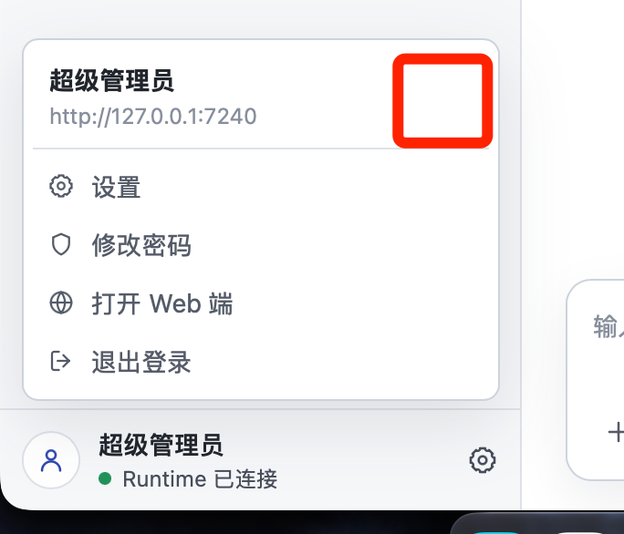

# 安装包管理与自动升级

- 记录日期：2026-09-28。
- 状态：已纳入并随 v0.29.0 于 2026-10-10 封版；macOS 升级由用户明确暂缓，其他已实测范围验收通过，见[版本总结](../versions/v0.29.0/版本总结.md)。
- 来源：下一版本规划讨论。
- 目标版本：`v0.29.0`，已完成归档；[总体设计](../versions/v0.29.0/总体设计.md)为版本基线，F01 独立设计按步骤确认。

## 用户原始要求

> 下个版本内容需要包括安装包管理、安装包自动升级的内容。

用户同时明确业务插件已迁移到独立仓库 `~/projects/ez-assistant-plugins`，
插件开发与打包不纳入本仓库下一版本范围。
此前提出的整套配色主题仍为候选，尚未确认与安装包管理、自动升级一起交付。

## 本轮已确认范围

- 安装包在企业管理后台管理，首版覆盖 Windows/macOS Desktop，包含随包 Runtime Host。
- 客户端启动及每 5 分钟自动检查更新，用户确认后才开始下载并安装；不默认后台预下载或静默安装。
- 更新发现与下载正式支持 HTTP 和 HTTPS，直接沿用企业中心地址，包括登录前升级；保留安装包签名与完整性校验。
- 普通更新按钮仅在有适用且可下载的更新时显示，位置为左下角账号菜单顶部的用户信息右侧；2026-10-02 用户取消常驻手动检查入口，见下方参考图及修订说明。
- 2026-10-02 用户明确简化：普通用户只需要知道需要更新，兼容、架构和版本选择由程序内部处理；停止当前在用的本机 Host，升级后启用随包 Host，不按原安装来源区分。
- 企业中心明确判定当前版本不兼容时，强制要求升级：客户端退回登录页并阻止进入业务界面，
  由用户手动点击“升级”后下载并安装；不能跳过版本门禁继续使用。
- 首版不包含 CLI Client 自动升级和个人公开分发渠道建设。
- 本次确认不等于已经批准具体技术方案、活动任务中断策略或代码实施。

## 已核查的现有基础

- Desktop 与 CLI Client 是同级产品，各自分发包内置 Runtime Host；Host 不单独作为产品分发。
- 企业中心已有插件包管理与受保护下载，但插件包分发不等于应用安装包管理。
- Desktop 已有本机旧 Host 的受控停止与新随包 Host 启动交接，见
  [`runtime_bootstrap/upgrade.rs`](../../apps/desktop/src-tauri/src/runtime_bootstrap/upgrade.rs)。
  已实现的旧交接限定个人模式、同安装来源的 `0.26.0` 旧 Host；2026-10-02 用户明确 F01 采用统一本机交接，原来源限制不沿用到目标设计。
  这一能力用于安装文件已更新后的交接，不包含应用新版本在线发现、下载和安装。
- 现有应用协议双向兼容检查、数据库准入和迁移备份机制应继续复用；安装文件恢复不能
  直接等同于数据库可降级或任务可无损恢复。
- 兼容判定已有两个明确层次：Desktop/Client 与 Host 使用 `version` 和
  `min_compatible_version` 做双向软件版本判定；Host 与 Center 使用中心信息中的
  `protocol_version`、`min_protocol_version` 检查企业协议兼容性，当前 Host 支持协议 1。
  后者已有 `ProtocolIncompatible` 错误。下一版复用这些事实接入登录页升级流程，
  不新增独立的强制升级开关或重复的最低兼容判定。
  2026-10-02 核查补充：上文协议 1 为最初记录时的实现；F06 后 Center 与当前 Host 已使用企业协议 2，F01 按当前实现设计，不恢复旧协议判定。
- CLI Client 当前通过 npm 分发，具有自己的 Host 来源与 systemd 生命周期约束；
  本版不升级 Client，但须核对 Desktop 与其共享本机 Host 时的边界。

## 下一版候选能力划分

以下为规划建议，不代表已确认的总体设计或实施授权。

1. **安装包管理与分发**：管理产品版本、系统与架构、更新说明和对应制品，完成上传、
   校验、发布及撤回；客户端只发现已发布且适用的完整制品。入口设在企业管理后台，
   本版不建设个人公开分发渠道；上传与发布的具体规则待设计。
2. **客户端自动升级**：完成检查、下载、校验、安装、重新启动和结果反馈；
   默认自动检查，用户确认后下载并安装。重启时机和活动任务处理待设计。
3. **升级生命周期与恢复**：衔接现有 Host 交接、活动任务处理、同机 Desktop/Client 共存、
   数据兼容及失败诊断。与远端 Host 连接时，本机客户端升级不隐含远端升级授权。

## 企业中心不兼容时的升级门禁

用户补充原文：

> 在明确企业中心不兼容的情况下，强制升级（回退到登录页让用户手动点击升级）。

- 区分普通可选更新和明确不兼容：普通发现新版沿用确认后下载安装；明确不兼容时必须
  返回登录页，升级到兼容版本前不能重新进入业务界面。
- “明确不兼容”优先由现有兼容声明和判定结果提供，不要求中心另造拒绝机制；企业协议版本
  与应用软件版本不可直接比较，兼容安装包选择需关联制品支持的协议范围。
- 强制的是兼容准入，不是静默执行安装；用户手动点击升级才开始下载与安装。
- 网络错误、超时、中心暂不可达、账号认证失败和未知响应不能当作明确版本不兼容。
- 登录页须展示不兼容原因及升级入口，升级检查与下载路径不能依赖已通过兼容准入的
  业务登录，否则会形成无法登录也无法升级的死循环。具体鉴权和协议机制留技术方案确定。
- 本机安装升级完成后重新校验兼容性，不能仅凭安装器退出就宣称可进入业务界面。
- 平台无可用兼容安装包、下载失败或安装失败时保留阻止业务准入的状态，提供明确原因和
  可行恢复入口，不回退为允许跳过升级。
- 退回登录页不等于停止 Runtime、取消活动 Run 或升级远端 Host；这些生命周期影响必须
  在设计中单独明确。还须区分不兼容对象是 Desktop、Host 还是 Center，不能对仅升级
  本机 Desktop 无法解决的情况虚构可修复承诺。

## 普通升级入口

用户补充原文：

> 正常升级的口子也需要留好，可以放在我红框里面的地方。

已确认位置：左下角账号菜单展开后，顶部用户名称与 Host 地址区域的右侧，位于菜单分隔线
上方。对应现有 [`AccountMenu`](../../apps/desktop/src/features/runtime-access/AccountMenu/index.tsx)。
2026-10-02 用户修订：每 5 分钟自动检查，不需要“检查更新”按钮，只有确有可用更新时才渲染更新按钮；该要求替代早期常驻入口建议，入口位置保持不变。

后续交互设计建议：

- 无可用更新时不显示按钮；发现适用且可下载的新版时显示紧凑更新入口，提供明确可访问名称。
- 点击打开简洁更新面板，提供更新说明和“更新并重启”按钮，用户确认后才开始下载；不展示兼容范围、架构、版本列表或 Host 来源选择。
- 面板呈现下载与校验、安装及失败恢复等实际状态；打开后制品不可用时说明原因。不能把下载完成
  表述为安装完成，也不能因关闭账号菜单丢失已开始的升级进度。
- 普通升级允许暂缓；与登录页不兼容升级入口共用版本发现、校验和安装流程，兼容门禁
  仍依据已有机制，不能被普通入口绕过。

具体图标、提示形式及面板布局留界面设计确定；本轮仅记录需求，不修改界面实现。

## 2026-10-02 本机 Host 升级简化

用户明确：将当前在用的本机 Host 停止，升级后启用随包 Host，不按来源判断是否接管。下载校验后复用既有受控停止，等待实际退出，安装后在同一 Runtime Home 启动新版；删除初稿的占用暂缓及来源分类流程。更新处用一次简短说明告知会重启应用、中断本机后台的任务和终端，用户无需另行选择或停止 Host。远端服务不属于这次本机停止范围。

## 待确认范围

- Windows/macOS 首版具体架构范围；自动检查频率已于 2026-10-02 确认为每 5 分钟。
- 尚未登录、登录失效或无法登录企业中心时的检查、下载与恢复路径。
- 本机交接已按上述用户要求确定；受控关闭、同一 Runtime Home 恢复及失败处理的实现细节留技术方案。
- 发布撤回、失败恢复和数据升级后的回退边界；不预先承诺自动降级。
- 整套配色主题是否同版纳入。

版本号已确认为 `v0.29.0`，范围收敛至总体设计；本记录不预定具体更新框架、数据库结构、
接口、签名方案或安装器实现。
