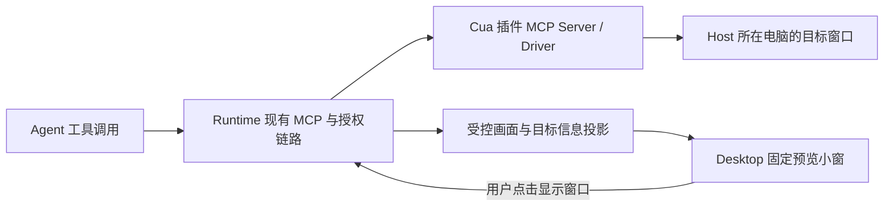

# Cua 接入、窗口独占与 Desktop 预览方案

> 2026-10-13 当前安排：原 v0.30.0 F02 已按用户要求移出本版本，改在 `codex/f02-computer-use` 独立分支推进，目标发布版本待定。设计入口为该分支的 `docs/design/computer-use/`；本文保留早期需求与验证背景，不作为主线已实现能力。

- 记录日期：2026-10-08。
- 更新日期：2026-10-09。
- 状态：外部 MCP 基础连接及画面读取已验证；后续产品方案与迭代顺序已登记，技术细节待定稿。
- 来源：用户对 Cua 仓库的调研要求及本轮连续讨论。
- 目标版本：待定；本次不扩大 `v0.29.0` 的既定发布范围。

## 用户确认的方向

采用 Cua Driver 作为 computer-use 驱动候选，最大程度复用 ez-assistant 现有 MCP
配置、工具发现与调用、权限审批、审计、取消和图片回传机制。

原目标是随包内置、插件式接入，但用户最后明确先通过外部 MCP 配置单独验证，暂不纳入
随包范围。验证期间使用普通外部 MCP 条目；未来随包能力的配置隐藏和不可编辑要求保留，
不反向限制本次外部验证配置。

实现方向是保留 Cua 原 MCP 入口，必要约束以小范围定制构建补充，暂不增加第二层 MCP
转发服务。原版 Cua 的工具连通不代表以下定制约束已经实现或通过验收。

## 窗口占用约束

- 同一窗口同一时刻只允许一个 ez-assistant 会话使用，占用归属使用 Runtime 的真实会话 ID。
- 会话可跨多次工具调用保持占用，同一会话重复访问自己的窗口允许继续；其他会话不能交叉操作。
- 用完必须释放，执行结束、取消或失败时兜底清理；释放前确认在途操作停止。
- 内部需要按窗口检查唯一占用，并能按会话找到待释放窗口；不把 Cua 可由调用方填写的
  `session` 标签直接当作可信的 ez-assistant 会话身份。
- 不默认将整个桌面的会话排成一队。窗口冲突可以等待或另选目标，具体等待方式在验证后收敛。
- 用户手动操作及不同窗口之间的应用共享状态暂不纳入协调范围。

现有 MCP 调用链尚未向外部 Server 提供足够的可信会话身份和执行结束通知；正式窗口独占
需要核实通用调用作用域的最小接入方式。不得通过提示词声称已获得自动隔离保证，也不为此
把窗口管理写入 Host 核心或让 Agent Core 持有 Runtime 业务 ID。

## 输入与剪贴板

- 后台操作作为默认，暂不增加拒绝前台输入的硬策略；不限制用户手动打开、切换或操作窗口。
- 优先使用直接文本输入、控件赋值或浏览器页面输入，绕开系统剪贴板。
- 需要检查显式剪贴板工具、复制/剪切/粘贴快捷键及驱动辅助路径，不能仅隐藏工具名就宣称
  完全不使用剪贴板。纯原版接入阶段不把这项定制要求标为已实现。

## 画面预览与后续集成

此前已确认预览是固定尺寸的画面小窗，不需要缩放；点击应拉起实际受控应用窗口，
不是放大缩略图。具体预览实现单独安排，外部 MCP 验证不隐含修改 Desktop 界面。

远程 Web 操作的对象就是目标 Host 所在电脑，不需要控制访问页面的那台电脑。
macOS 权限身份、Windows 交互桌面、正式签名和打包属于后续实际集成核查点，
原版外部接入的身份不能直接当作未来随包身份的验收结果。

## 本次验证边界

先固定候选版本，准备普通外部 MCP 配置并验证连接、工具目录及适用的截图/输入链路，
随后针对会话归属、窗口占用、正常释放和取消清理验证定制实现。Windows 必须另做实机验证，
不能由 macOS 握手或源码检查替代。

隔离验证文件使用项目 `.runtime-test/` 下新建目录。用户随后明确授权直接配置到生产环境，
已通过正式设置界面向当前企业账户的 `mcp.json` 新增 Cua 外部条目，并保留原有配置和独立备份。
正式接入采用签名的 CuaDriver.app 后台服务及原 MCP 代理，显式指定服务连接位置，适配 Host
过滤继承环境变量的启动方式；遥测和自动更新检查已关闭。生产 Host 连接测试、窗口截图及
无障碍读取通过；实际输入、窗口独占/释放、Windows 实机及预览交互仍待后续验证或实现。
本次未修改产品源码，也不把验证依赖加入 Desktop/Client 分发资源。插件源码与开发记录遵循根
`AGENTS.md` 的独立插件仓库边界；若需主仓库通用 MCP 契约变更，再确定所属版本和实施计划。

## 资料

- [Cua 仓库](https://github.com/trycua/cua)。
- [Driver 工作机制](https://cua.ai/docs/cua-driver/concepts/how-cua-driver-works)。
- [Driver Session 工具](https://cua.ai/docs/cua-driver/reference/mcp-tools/sessions)。
- [Driver 文本输入](https://cua.ai/docs/cua-driver/reference/mcp-tools/keyboard)。
- [既有 MCP 本地浏览器输入](260903-MCP本地浏览器操作版本范围.md)。

## 后续版本方案草案（2026-10-09）

用户要求形成方案并纳入后续版本迭代计划。本节承接上述已确认约束，不扩大当前
`v0.29.0`，不预定后续版本编号或发布日期；正式启动时再归入确定版本的 Feature，
形成该版本的设计与实施计划。本次只登记方案，不开始实现或继续操作生产验证环境。

### 1. 产品结果与接入方式

最终提供随包的 computer-use 插件能力，普通用户无需安装 Driver、填写命令或编辑配置。
内置能力描述及路径解析仍由受保护的插件配置承载，经过真实 MCP 注册与执行链路接入；
不只是 UI 映射，也不将 Cua 装配分支写入 Host 主流程。内置条目不写入、不导出为用户可编辑
的 `mcp.json`，用户界面不暴露命令、参数、环境变量及包内路径的编辑入口。
受保护条目不出现在用户独立 MCP 配置列表或配置导出中；必要的 computer-use 能力状态展示
与内部配置分开，不以隐藏编辑按钮代替配置不可见。
现在的外部 Cua 条目继续作为独立验证配置，随包实施时明确处理同名和重复启用，不能静默覆盖。

操作目标始终是当前连接的 Host 所在电脑。Desktop 与无图形 Client 共用工具接入；
Client 自身无需预览 UI，但执行端仍须满足目标操作系统的交互桌面要求。

Desktop 提供固定尺寸的画面小窗：显示正在操作的目标应用、来源会话和画面更新时间，
支持拖动、收起及恢复；不提供缩放、拖边调整尺寸或直接在画面中点击操作。
点击画面发送明确的“显示目标窗口”意图，将实际受控应用窗口拉到 Host 的前台。
这是用户主动操作，自动更新画面不改变前台或真实鼠标位置。

### 2. 执行与展示分层

| 所属层 | 负责内容 | 实施边界 |
| --- | --- | --- |
| Cua 插件 / Driver | 窗口操作、截图、窗口唯一占用、直接文本输入、目标激活 | 在独立插件仓库维护定制与构建，保留原 MCP 入口，不增加第二层 MCP 转发服务 |
| assistant-runtime | 真实用户/会话/执行作用域、既有审批审计、结束与取消通知、受控展示投影 | 只补当前消费者确实需要的通用插件/MCP 接入，不持有第二份 Driver 窗口占用表 |
| runtime-host | 插件进程和资源适配、现有认证及 HTTP/SSE 传输 | 复用原监听；不新增公开 Driver 端口，不在 Host 核心增加 Cua 专用调度 |
| assistant-protocol | 客户端需要的目标、画面引用及显示窗口意图 | 只传稳定且有界的 DTO，不暴露原始 MCP 对象、任意文件路径或操作系统句柄 |
| Desktop | 小窗创建、位置、收起、画面展示、点击意图 | 允许必要源码改动；不装配 Driver，不持有窗口独占或 Run 权威状态 |

MCP 继续承担工具发现、操作和授权链路；预览是产品客户端能力。此次方案并未确认
Codex 的内部实现；公开说明只能证明其 Computer Use 插件及 macOS 画中画体验存在，
不能据此断言其画面协议或采集频率。

### 3. 最小契约补充与窗口独占

现有 `ToolContext` 有调用标识、取消信号和输出回调；`McpConnection::call_tool_once`
目前传入工具名、参数及取消信号，不携带可信产品会话身份。工具图片已有落盘、可靠引用
和受认证读取能力，`structuredContent` 已进入 JSON 结果，但原始 MCP `_meta` 不跨 Host
Adapter 边界。上述事实说明：截图链路可以复用，可信作用域与预览目标绑定仍需补充，
不能从工具名字、JSON 任意字段或模型填写的 Cua `session` 推断权限和窗口归属。

- Runtime 在既有 Run 工具装配时绑定真实作用域；通过显式声明支持的插件/MCP 扩展交付，
  不把产品 Session ID 引入 Agent Core，也不让模型填写或覆盖该作用域。普通 MCP Server
  保持原调用行为；扩展须在正式设计中核对握手、传输和可信调用来源。
- 占用归属使用真实 Session ID，用户域和 Host 实例用于身份命名空间。唯一占用检查落在
  实际共享的 Driver 内，不能每条 MCP 连接各维护一份锁。按会话检索窗口、按窗口检查会话，
  两个方向由同一份内存事实派生，不新增数据库表。
- 窗口键关联进程实例和窗口身份，窗口关闭或标识复用后失效。同一会话重复访问允许继续；
  该会话内并行子任务或工具调用对同一窗口也须串行执行，不能仅凭会话相同就并行写入。
- 读取用于发现的窗口列表不占用窗口；选定目标并开始任务使用时取得占用。截图、输入及
  后续目标操作核验该占用，跨调用保持；用完显式释放，整个 Run 结束、取消或失败兜底释放。
  子任务结束只回收其已不再使用的目标，不能释放同一会话其他在途执行正在使用的窗口。
- 第一版对冲突返回有界的“窗口正在被其他会话使用”，允许换窗口或稍后重试；不建立桌面
  全局排队、不无限等待，也不自动重试已经可能产生副作用的调用。
- 释放先收敛在途操作。连接断开或超时不足以证明操作已停止；状态不明时保持不可再分配，
  确认停止或完成 Driver 清理后才可重新占用。重连不得只靠同名会话标签恢复旧操作权限。

后台输入不额外拒绝用户切换前台或手动打开窗口，用户手动干预及应用跨窗口共享状态仍沿用
已确认的不协调边界。剪贴板单独处理：直接输入优先，显式剪贴板工具、复制/剪切/粘贴
快捷键与辅助实现路径均需核对；不能用“保存后恢复剪贴板”替代不干扰剪贴板的目标。

### 4. 预览与点击链路

第一版采用“随工具结果更新”的预览。插件在成功读取画面后，返回图片及经过契约约束的
目标标识；Runtime 将已验证的目标与准确 owner、执行、调用和图片引用绑定，再形成客户端
投影。普通工具图片不会自动弹出小窗，不能对所有图片都猜测一个受控应用。

复用 `SessionToolImage` 的可靠结果引用、文件校验与 HTTP 读取，不新增预览图片表或重复存储。
现有模块限制它只用于工具详情；正式版本必须明确增加“受控预览展示”的消费范围，并同步
修改模块约束和所有消费者，仍不将其变为附件、产物或导出文件。单纯展示复用已授权取得的
图片；额外采集新画面仍须检查对应权限。

Desktop 以固定尺寸的独立 Tauri 小窗承载预览，自动显示和刷新不抢焦点，主窗口隐藏时可保留
预览；退出 Desktop 只销毁展示和相关连接，不停止 Runtime 的任务。小窗复用现有连接与身份，
不得获得额外权限；身份/Host 切换清空旧画面和目标，迟到结果不能覆盖新连接的展示。
跨会话并发时只显示一个明确选择的来源，提供来源切换，避免不同会话的画面争抢同一小窗。

点击只提交受控目标引用。Runtime 重新核验当前身份、来源会话、目标占用及窗口有效性，再通过
插件激活目标；不能让 WebView 提交任意 PID、句柄或命令。该显式动作复用可适用的既有授权
与审计，不能因属于 UI 点击就绕过权限。目标已释放、关闭或权限失效时不执行激活。
连接远端 Host 时激活远端目标，不在本机按相同 PID 找应用。

Run 结束或目标释放后小窗隐藏；画面等待更新时显示实际时间，不能声称是实时视频。
重连从可查询投影恢复，不仅依赖 SSE；旧截图即使仍在历史中，也不能恢复已释放目标的激活能力。
预览请求、读取失败或用户收起小窗都不改变执行状态。

持续预览单列后续迭代：确有需求时才增加按需、低频、只保留最新帧的采集与读取。
采集必须绑定既有目标占用和可见订阅，无订阅停止采集；新帧不进入模型上下文或 Conversation，
不能每帧落入历史 tool-image 目录。优先复用 MCP 可协商的资源能力与现有 Host 认证通道，
不预设视频编码、额外端口或新媒体服务；正式实现前核对资源订阅、取消、背压与内存上限。

### 5. 平台与随包边界

- macOS：原版外部验证的 CuaDriver 身份已可用；随包时重新验证实际启动责任链、签名、
  辅助功能/屏幕录制权限显示及更新后的权限保持。Driver 的任务生命周期由 Runtime 管理，
  不绑定 Tauri 退出；权限身份和谁启动服务分别核验，不从进程父子关系推导授权归属。
- Windows：Driver 运行在 Host 对应的交互用户桌面，Client/服务模式不能自动获得另一个
  登录会话的桌面。逐项实测窗口后台截图、UIA/窗口消息输入、中文及目标激活；后台能力
  不支持时明确返回结果，不静默切到全局前台注入。需要前台的场景在后续交互设计中明确
  用户授权和提示，不把“macOS 能后台操作”当作 Windows 验收结论。
- 固定版本、包校验、签名和许可证纳入插件构建与发布；保留关闭遥测和自动更新检查的配置，
  Driver 更新跟随产品/插件发布，不在后台自行替换。Cua 全仓库的其他组件不自动纳入依赖。
- 随包描述和能力映射属于产品资源及插件配置，安装路径由实际运行的 Host 解析；不写死
  当前 `/Applications` 路径。是否允许整体禁用沿用正式插件策略，不额外开放内置配置编辑。
- Web 可复用同一来源和受控画面投影，系统级置顶小窗只由 Desktop 提供。远端控制和查看
  始终遵守原有身份/权限；不因能连接 MCP 就视为获得整个系统桌面的访问权。

### 6. 后续迭代顺序与验收

下表是版本候选的实施顺序，尚不是已获实施授权的里程碑。确定目标版本后再按开发流程
细化 Feature 与里程碑，每一里程碑完成后分别确认。

| 顺序 | 候选交付 | 进入条件与完成判定 | 当前状态 |
| --- | --- | --- | --- |
| 1 | 外部 MCP 操作适用性核查 | 接续用户实测结果；确认实际输入、取消、后台行为和剪贴板路径，区分平台支持范围 | 基础连接和画面读取已验证，操作适用性待用户测试反馈 |
| 2 | 可信作用域及窗口独占 | 先定稿最小 MCP 扩展；同窗口跨会话拒绝、同会话串行、不同窗口可并发，正常/失败/取消释放及断连未知状态有明确结果 | 未开始 |
| 3 | Desktop 固定预览与目标激活 | 复用可靠截图；显示来源和更新时间，点击真实目标，覆盖来源切换、迟到响应、已释放目标、主窗隐藏和退出；不发生自动前台切换 | 未开始 |
| 4 | 受保护的随包插件及跨平台验收 | 插件包、隐藏不可编辑配置、路径解析、签名/权限/升级通过；macOS/Windows 各自实测，Client 无 UI 仍可执行；基础产品不依赖插件才能启动 | 未开始 |
| 5 | 按需持续预览 | 基于前述结果确认刷新需求，才定稿采集契约；无模型/历史帧堆积、慢客户端丢旧帧、无订阅停止、目标释放后不能继续采集 | 后续可选，不作为第一版完成条件 |

正式验收还须确认：旧 MCP、审批、审计与工具详情图片不回退；预览失败不取消 Run；
两会话/子任务的目标不会串画面，点击远端目标不会误操作本机；权限撤销和 Driver 更新后
错误可见、清理可核实。窗口独占、持续预览及 Windows 后台支持不以提示词或源码推断验收。

待正式设计收敛的事项包括：可信作用域及生命周期扩展格式、插件受保护配置的最小接入点、
预览投影与控制命令、macOS 随包权限身份、Windows 实测支持矩阵。仅当现有通用机制无法
承载这些明确调用方时才补充契约，不先建设 UI 插件框架、媒体服务或常驻 Worker 池。

参考：[Codex Computer Use 公开说明](https://learn.chatgpt.com/docs/computer-use)、
[macOS 画中画体验说明](https://learn.chatgpt.com/use-cases/use-your-computer-with-codex)。
