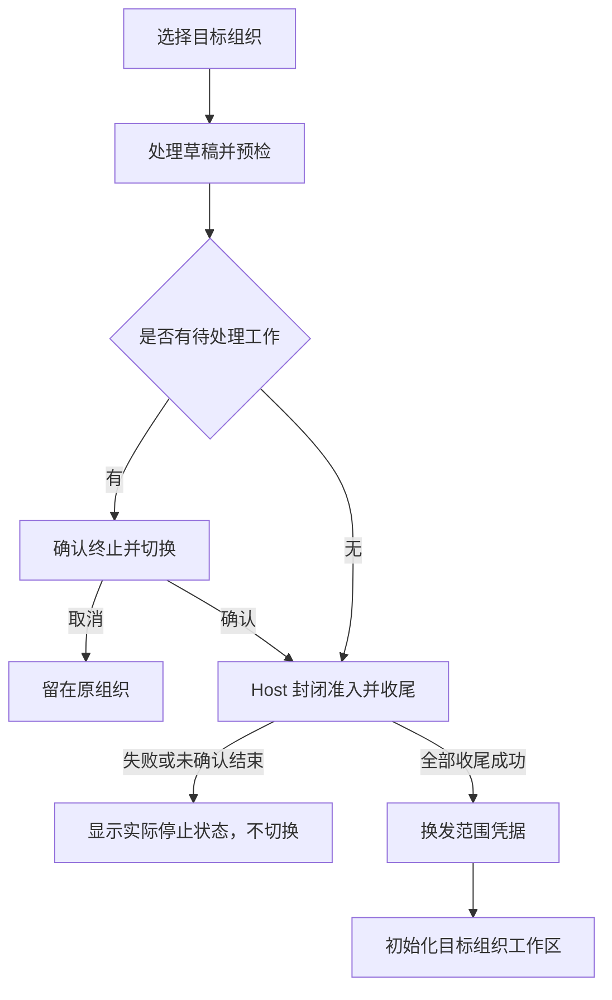

# v0.33.0 F01 界面交互设计指导：组织选择与管理范围

## 一、设计信息

- 日期：2026-11-04；状态：**F01 开发基线**。纳入左下角账号菜单入口修订，实施状态见[开发计划](开发计划.md)。
- 依据：[功能设计](功能设计.md)、[技术方案](技术方案.md)、[总体设计](../../总体设计.md)。JWT 与 7 天有效期按用户最新要求；默认组织承接旧企业数据。
- 约束：[后台模块](../../../../modules/enterprise-admin.md)、[后台前端规范](../../../../specs/企业后台前端开发规范.md)、[后台主题 Token](../../../../specs/企业后台主题Token设计.md)、[Desktop 模块](../../../../modules/desktop.md)、[前端规范](../../../../specs/前端编程规范.md)。
- 保持现有产品外观：后台使用 Ant Design 与现有布局，Desktop／Host Web 使用现有登录布局、SelectionPopover、Dialog 和语义主题。不引入新设计系统或客户端多窗口。
- 本文给出页面、文案和状态流转；权限以中心为准，停止结果以 Host／Runtime 为准。页面不得展示 Token、jti、物理目录或内部状态机字段。

## 二、现有入口与调整位置

下列路径相对仓库根，列出本 Feature 的主要实现入口。

| 现有位置 | 本 Feature 调整 |
| --- | --- |
| `apps/enterprise-admin/src/app/IdentityRoutes/index.tsx`、`routes.tsx` | 登录后先选择范围，路由按范围准入；根路由和缺失页不再一律跳用户管理 |
| `apps/enterprise-admin/src/app/PageLayout/index.tsx`、`NavigationMenu/index.tsx` | 顶部新增唯一范围入口，导航按系统／组织互斥展示；布局仍只组合子组件 |
| `apps/enterprise-admin/src/stores/AdminStore.ts`、`app/NavigationGuard/index.tsx` | 复用身份、写入门、离开确认和换 Token 整树卸载，不另存可变当前组织 |
| `apps/desktop/src/features/runtime-access/DesktopEntryPage/index.tsx`、`WebLoginPage/index.tsx` | 企业账号认证后进入组织选择步骤；纯本地模式沿现状 |
| `apps/desktop/src/features/runtime-access/ApplicationConnectionStore.ts` | 展示选择、预检、停止、换发、初始化及恢复状态，不自判任务已终止 |
| `apps/desktop/src/features/runtime-access/AccountMenu/index.tsx` | 左下角账号菜单内的姓名下方显示组织切换入口 |

## 三、首次登录与选择

### 3.1 两端共同规则

账号密码正确后进入组织选择步骤。企业后台在同一登录卡片内将账号密码表单替换为组织选项和“进入”按钮，认证和换发等待都留在卡片内。修改密码、退出登录属于进入工作区后的账号菜单。企业后台默认选中列表第一项，用户可改选，点击“进入”后才换发范围 Token。Desktop／Host Web 仍在组织选择步骤提供退出登录。工作区在选定有效范围后挂载。

现有 AdminStore 登录／恢复仅接受全局 admin 的判断必须同步调整：有效账号先取得身份，再按服务端可管理范围决定入口；组织管理员不能因全局角色是普通账号而被拒绝。空范围页面没有业务权限，不能把此调整实现成允许所有账号直接进入后台页面。

后台选项展示组织名称和编码，同名组织通过编码区分。账号身份由工作区的账号菜单呈现。搜索筛选服务端允许的范围，无结果和无权限分别显示。

| 身份与入口 | 可选内容 | 无可选组织时 |
| --- | --- | --- |
| 后台系统管理员／超级管理员 | “系统管理”置顶，与组织列表分组；包含停用组织且明确状态 | 仍可选择系统管理创建组织 |
| 后台组织管理员 | 本人有管理权限的启用组织 | “暂无可管理的组织”，提供重新检查 |
| 后台普通成员 | 无后台管理范围 | “当前账号暂无后台管理权限”，提供重新检查 |
| Desktop／Host Web 企业用户（包括系统管理员） | 本人是有效成员的启用组织；无系统管理选项 | “暂无可进入的组织，请联系管理员”，提供重新检查、退出登录 |

点击“进入”期间禁重复提交；失败保留目标选项及错误，重新检查权限后才能重试。请求结果不明先核验当前身份，不能据已选名称展示成功。登录页的按钮在企业模式使用“登录”，组织选择页使用“进入”，避免认证完成前承诺已进入工作区。

### 3.2 刷新与深链接

已有有效凭据刷新先核验身份和范围：成功后恢复同范围且仍有权访问的页面，无需每次刷新重新选择；恢复期间不闪现旧业务或登录表单。首次登录的未选范围 Token 仅驻留内存，刷新回到登录表单。选择系统管理或组织成功后才写入会话 Cookie。

未选范围打开业务地址进入登录入口；在已有范围下打开不匹配范围的地址显示“此页面不属于当前管理范围”，提示使用顶部“切换组织”，不自动换范围。跨组织详情不可访问且不暴露对象名称；组织切换后落到目标入口，不沿用旧详情 ID。浏览器后退也重新经过身份和范围守卫。

## 四、企业中心布局与导航

### 4.1 唯一切换入口

顶栏在账号菜单左侧显示范围菜单，使用与账号菜单一致的文字按钮、图标和下拉箭头。系统范围显示“系统管理”，组织范围只显示当前组织名称。

点击范围名称展开下拉菜单，列出账号可管理的组织及适用的“系统管理”选项。当前项高亮并禁用。点击其他项发起切换，有未保存草稿时先确认。停用状态在下拉选项中呈现。

组织列表、成员详情、模型页不增加第二个切换入口，也不出现“返回系统管理”按钮。组织业务表单没有可编辑的组织归属下拉框。

| 当前范围 | 导航 | 默认落点 |
| --- | --- | --- |
| 系统管理 | 组织管理、用户管理、安装包、系统审计；既有平台配置能力在对应系统页面提供 | 组织管理 |
| 组织管理 | 组织成员、插件管理、智能体管理、模型管理、设备管理、调用记录、用量统计、反馈中心、组织审计 | 组织成员 |

不新增统计大屏或空白“工作台”。公开地址等原模型页中的平台字段移到系统范围的配置区域；公开官网首页链接仍沿现状，不将 F01 扩成官网编辑器。

### 4.2 后台切换流程

1. 打开选择器并选择目标；当前页面仍属于原范围。
2. 有未保存草稿时，复用唯一 NavigationGuard，提示“切换后将放弃当前未保存的修改”，按钮为“继续编辑”“放弃修改并切换”。不提供自动跨组织保存。
3. 已发写入尚未完成时禁止切换，提示“当前操作尚未完成”。结果未知则先提供“重新核对”，不把关闭弹窗当作写入取消或成功；服务端结果核实后再切换。
4. 换发期间显示“正在切换…”，暂禁业务写入和重复切换，保持原范围标识。成功后更新身份、卸载旧页面、清理草稿和敏感正文，再进入目标范围默认页。
5. 明确失败且旧身份有效则留原范围；响应未知时遮蔽业务内容并核验身份，失效则重新登录。旧请求的成功、失败或 401 不覆盖新身份。

后台切换不调用客户端任务停止接口。客户端组织切换的受管任务确认仅在 Desktop／Host Web 流程执行。

## 五、组织、全局用户与组织成员

### 5.1 系统“组织管理”

列表显示名称、编码、启停状态、有效成员及组织管理员概况；数量来自服务端。操作为新增、编辑名称／编码、启用／停用；不提供删除、复制业务数据或“进入管理”按钮。

新增组织时填写名称、编码，并从有效全局账号中明确指定首位组织管理员；创建组织和建立该成员关系作为同一次成功提交展示。系统管理员可指定自己，但须明确选择，不自动加入。没有可用账号时提示先在系统“用户管理”创建；不把账号创建嵌入组织表单。

停用确认展示目标名称及影响：“成员将无法进入该组织，模型调用和设备访问将受限；历史数据保留。”失败保持原状态；不按本地开关提前展示成功。恢复后不自动恢复已撤销设备授权或重放任务。

### 5.2 系统“用户管理”

沿用现有用户列表和编辑表单，每个账号一行，包含零组织账号。列为账号、显示名、账号状态、系统角色、组织归属摘要及操作。组织筛选只过滤全局账号列表，不改变范围。

用户表单通过“系统管理员”开关授予或撤销系统权限，超级管理员的开关固定开启。全局停用、删除、系统权限变更及密码重置沿既有保护和确认。涉及最后一名管理员时由服务端校验。

点击“组织归属”列中的组织数量打开成员关系列表。组织名称、组织编码、组织角色和操作各占一列。点击“新增组织”可选择尚未加入的启用组织和初始角色。角色在行内修改并即时保存。点击“移除”并确认后删除成员关系。保存成功后更新列表及摘要。新增全局账号后须显式分配组织，历史升级沿用默认组织迁移规则。

### 5.3 组织“组织成员”

| 内容 | 系统管理员／超级管理员 | 组织管理员 |
| --- | --- | --- |
| 账号、显示名、本组织角色、账号可用状态、成员状态 | 查看、搜索、筛选和分页 | 同样可读 |
| 添加已有账号到本组织 | 可操作；候选由受限服务端接口提供最小安全字段 | 不显示按钮，无全局账号候选查询 |
| 调整成员角色、启停、移除 | 可操作；区分“停用本组织成员”与全局停用 | 只读，无编辑按钮或可交互开关 |
| 密码、系统角色、其他组织信息 | 本页不编辑，需通过统一切换进入系统用户管理 | 不提供 |

每个成员仅一个组织角色，表单为“普通成员／组织管理员”单选，不做角色多选。账号停用与成员停用分列，不合成一个含糊的“禁用”。系统角色不自动出现在成员列表，只显示真实成员关系。

移除／停用成员须说明影响本组织访问及设备授权，历史保留；重新加入不会自动恢复设备授权。移除、停用或降级最后一名有效组织管理员时，服务端拒绝并提示先指定其他有效管理员；未知结果先重读，不重复提交。

### 5.4 组织业务页面

模型、插件、智能体等复用原页面，仅按当前范围加载；F01 模型仍为单默认模型，F02 的个人配置和多模型选择不提前露出。

设备详情沿用设备信息／可用用户分区编辑，授权候选只来自本组织有效成员；组织管理员可以审批、授权、注销。调用策略、记录／正文、用量、反馈和组织审计均限当前组织；审计只读，正文仍须显式点击查看。敏感读取审计失败时不展示正文。系统范围不汇总展示组织业务正文。

停用组织仅系统管理员可进入管理，持续显示“组织已停用”，不误示成员可用。恢复组织状态通过统一切换进入系统“组织管理”；成员调用与设备使用禁用，不以后台可查看表示业务已恢复。

## 六、Desktop／Host Web 单窗口组织切换

### 6.1 布局与入口

点击左下角账号行打开菜单。企业模式用分隔线将姓名、组织切换和账号操作分为三组。组织切换显示当前组织名称及下拉箭头，可访问名称为“切换组织，当前组织：名称”。账号操作保留设置、反馈中心、修改密码、打开 Web 端和退出登录。

Host 地址由既有连接设置查看和修改。纯本地模式沿用整行账号入口，隐藏组织选择。组织选择仅在侧栏展开时显示，折叠后可重新展开侧栏操作。

点击组织名称在菜单内折叠或展开列表。当前组织始终显示在标题，列表只显示其他组织。标题与选项等宽，文字左对齐。选择其他组织后关闭菜单，进入下述预检和任务处理流程。企业中心后台仍使用顶栏统一“切换组织”。

切换只改变当前 Host 的企业组织用户域，中心地址和目标 Host 通过既有连接设置修改。组织列表复用 DropdownMenu，任务影响及等待用产品 Dialog。

### 6.2 草稿、预检与确认

用户选目标后先处理未保存配置、编辑文件和未发送输入。已有可靠的按组织保存能力则留在原域；只存在 UI 内存的内容须明确提示舍弃，不承诺已经保存。附件选择、资源标签和草稿不得自动带入目标域。取消舍弃确认即停止本次切换。

Host 预检目标及原域工作，期间显示“正在检查任务…”。检测范围为当前 Host 上本人原组织的全部受管会话工作，不只当前打开的会话；UI 不根据运行图标或会话列表自行判断空闲。

有活动工作或待执行队列时显示：

> 切换到「目标组织」？
>
> 需要先终止当前组织中的任务。未执行的排队内容会保留，返回后需手动恢复；已经发生的操作不会回滚。

影响摘要仅展示 Host 可核实的会话／任务、审批等待和队列数量，分类不能重复计数；允许展开会话名称，不展示完整敏感提示词。按钮为“取消”“终止并切换”，危险动作使用既有危险色。无工作时不弹终止确认，但仍走 Host 准入封闭和安全切换流程。

确认期间出现新增工作，按 Host 回执重新展示影响并要求确认；原工作自行完成不增加确认。预检目标失效则停留原组织，不先停止任务。

### 6.3 停止与交换状态

| 状态 | 展示与操作 |
| --- | --- |
| 正在停止任务 | 原组织名称保留，显示“正在终止任务…”；禁止发送、审批放行、队列恢复和重复切换，不提供伪造百分比 |
| 等待工具／存储收尾 | 显示 Host 返回的具体等待项，不以 Run 已取消宣称所有工作结束 |
| 正在切换组织 | 仅在收尾确认后出现；等待换发，不提前显示目标业务 |
| 正在加载目标组织 | 新身份已生效后显示目标名称，旧会话与资源不作为加载占位 |
| 停止失败或超时 | 显示“尚未确认全部任务结束，未切换组织”，列未完成项；提供“重新检查状态”，不自动重发停止或换发 |
| 中途断开 | 显示“连接中断，正在核实切换状态”；重连查询 Host 操作，不推断成功，也不自动重放命令 |
| 换发失败 | 按实际身份停留原范围或重新登录；已停止的任务不恢复 |
| 目标初始化失败 | 已切入目标身份，显示“组织已切换，工作区加载失败”，提供重试初始化；不能复活旧 Token |

停止开始后没有“撤销终止”或“保留任务切换”按钮。关闭窗口不撤销 Host 正在执行的操作；重新打开先查询状态。等待 Dialog 不允许 Escape／遮罩点击关闭；故障结果可关闭查看仍有权访问的原域状态，但关闭不代表恢复工作。原域已经关闭时，重新进入须由 Host 正常初始化，不自动重放队列。

切回默认组织或其他曾进入组织可读取其历史；队列显示“需要手动恢复”，复用既有恢复入口。切换成功后只加载目标会话、设置、插件、记忆、资源和订阅；不会复制旧数据。设备登记组织不匹配时，组网区域显示不可用原因，本地组织工作区仍可使用，不自动重新登记设备。

## 七、升级后的首次体验

旧中心升级创建一个稳定默认组织，旧账号保留并成为其成员。用户重新登录后仍需明确选择组织；选择默认组织即读取原有企业工作区。只有存在可信历史绑定时，首次选择处可展示“原有企业数据归属于此组织”的说明，不显示目录名，也不要求用户挑选数据要迁入哪个组织。

默认组织名称可改，归属不能按名称或首次选择猜测。先选择新组织时显示正常空工作区，不提示旧数据丢失，也不把旧数据导入。纯本地模式历史不进入企业组织。

系统管理员若发现默认组织尚无有效组织管理员，在组织列表显示初始化待完成状态；通过统一选择器进入该组织成员页，明确指定有效成员为组织管理员。此操作不妨碍系统管理员管理已有组织，不将原管理员自动批量设为组织管理员。

目录绑定冲突、历史归属未确认或存储升级失败时显示“历史工作区暂不可用”，提供重试检查和可复制的错误编号；不创建空白目录掩盖历史、不提供一键覆盖／合并。旧端协议不支持时显示升级入口；升级发现不能依赖组织登录已成功。

## 八、到期、撤权与异常

| 情况 | 交互规则 |
| --- | --- |
| JWT／Host 登录到期 | “登录已过期，请重新登录”；遮蔽业务投影并关闭失效访问。7 天不是保证浏览器记住登录 7 天，不增加记住登录选项 |
| 中心暂时不可达 | 未到期时保留当前身份和既有临时故障体验；选择／切换不可用，提供重试。到期后不能继续借离线状态授权 |
| 账号或凭据失效 | 清除匹配当前凭据的投影并重新登录，不显示旧敏感内容 |
| 组织／成员权限失效 | 重新核验身份；Token 仍有效时刷新可选组织，已撤销则重新登录，不使用旧 Token 偷换到其他组织 |
| 后台管理角色丢失 | 清理管理页；仍有其他管理范围则重新选择，否则显示无后台权限，不把普通成员升级为管理员 |
| 写入或交换结果未知 | 明确“结果尚未确认”，先查询真实状态；不能自动重新发送，更不能切到新组织后重试原写入 |

客户端登录到期不是组织切换确认，不自动清空历史、取消全部业务工作或承诺在途模型请求继续成功；已接纳任务由 Runtime 按真实结果收尾。重新登录及初始化不得自动重放。自然到期、撤权、停止失败和网络故障不能共用“网络错误”文案。

## 九、视觉、无障碍与验收

- 沿用现有浅／深色主题和字号，不新增品牌色、全页渐变或装饰性信息卡。范围名称允许截断并补充完整可访问名称；编码与权限状态不只靠颜色表达。
- 选择器支持键盘单选、搜索、清晰焦点和当前项标记；确认弹窗默认焦点放非破坏操作。弹窗关闭回到发起控件，切换成功焦点进入目标页标题或主区域。
- 加载和步骤变化用适度的 aria-live 通知，错误可读且附必要错误编号；不朗读 Token 或凭据。小窗口中选择列表与影响摘要内部滚动，主要操作保持可见。
- 真实链路验收覆盖：三类身份首次选择、零／单／多组织、系统与组织导航、只读成员页、统一切换和草稿、停止确认新增工作／失败／重连、旧响应隔离、到期与离线、默认组织旧历史及新组织空白、停用与最后管理员保护。
- 菜单隐藏不代替 API 鉴权；前端模拟不代替中心与正式 Host 验证。此文仅完成设计核对，未做实现、浏览器验收或数据迁移。

下一步：确认[版本 Feature 台账](../../开发计划.md)与[F01 开发计划](开发计划.md)后启动 M0；实现按里程碑逐步验收，不把本次计划推进视为实现授权。
